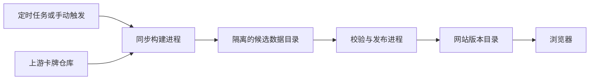
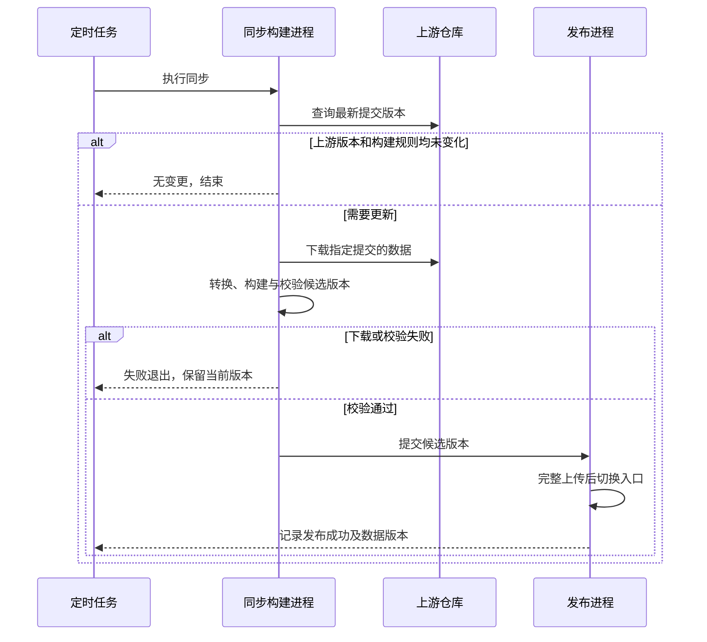

# 卡牌数据自动同步方案

本文记录自动同步方案及实施选择。第一期支持中文数据，部署于用户指定的常驻服务器；代码仓库为 `cloudsmiles/ptcg-browser`，网页入口为 `/ptcg/`。

## 1. 架构设计

目标是上游新增或修正卡牌后，自动生成可浏览的数据；下载或校验失败时继续提供上一版。

- 定时任务：本机或服务器使用系统定时任务；托管在 GitHub 的项目可使用 GitHub Actions，即仓库提供的自动执行任务。两者调用同一个同步入口。
- 同步构建：查询上游版本，下载该版本的数据，复用现有中文转换和浏览器数据构建逻辑。
- 校验发布：候选数据通过检查后才切换线上版本，保留上一版以便回退。
- 页面加载：一个页面会话的首屏、索引、详情及图片绑定同一版本。

## 2. 关键流程时序图

前置条件：已配置数据来源、输出目录和发布方式，首次执行允许没有历史版本。

图中节点均为进程或外部服务。成功后新访问者取得完整的新版本，已打开页面仍可访问其旧版本资源。

## 3. 关键逻辑

### 数据来源与版本判定

问题：当前 `build_chs.py` 读取固定临时文件，图片版本也是写死的，无法持续同步。

候选方式为网页抓取、每次下载整个仓库、查询提交后下载单个数据文件。推荐第三种：已确认 `duanxr/PTCG-CHS-Datasets` 根目录存在 `ptcg_chs_infos.json`，可复用现有解析方式，避免下载全部图片。

先解析上游默认分支对应的完整提交标识，再从该提交下载数据。数据与图片统一使用该标识，避免下载期间上游发生变化。上次成功发布记录同时保存来源版本和构建规则版本；任一变化均触发构建，支持强制重建。只有发布成功才更新成功记录。

构建规则版本由中文转换脚本、浏览器构建脚本和影响数据格式的配置共同计算，避免修改转换逻辑后仍跳过构建。实施第一步先实际下载最新数据并验证转换兼容性，通过后再接入定时发布。

### 触发方式

问题：同步程序需要在无人操作时持续运行。

候选方式为页面打开时同步、独立系统定时任务、GitHub Actions。页面同步会拖慢访问且需要额外写入服务，不推荐。建议默认每天检查一次，并支持手动触发；本机或常驻服务器选系统定时任务，GitHub 托管和自动部署选 Actions。云端定时执行可能延迟，不承诺精确到分钟。

实施选择：服务器使用 systemd 定时器，每天北京时间 04:15 检查，并增加最多 5 分钟随机延迟；GitHub Actions 只做回归检查。已确认上游 JSON 为 28 MB，超过 CDN 的 20 MB 文件限制，下载使用 GitHub API 的原始内容响应，避免依赖本服务器不可达的 GitHub Raw 域名。

### 数据质量与故障处理

问题：上游格式变化、返回不完整数据或网络异常可能覆盖可用版本。

候选方式为直接覆盖、仅检查下载成功、隔离构建后校验。推荐隔离构建：网络请求设置超时和有限重试；检查 JSON 结构、关键字段、卡牌与系列关联、详情定位、首屏与索引版本一致性。原始卡牌 ID 已有重复，不将其唯一性作为通过条件。

空数据必须拒绝；数量异常减少默认阻止发布，阈值建议先设为较当前版本减少超过 10%，后续结合实际数据调整。合法的大幅删减需人工核对后显式放行。图片只抽样检查，不批量下载或预热全部缩略图。并发任务使用互斥机制，避免重复发布。

### 一致发布与回退

问题：现有首屏及索引文件地址固定，后台延迟加载索引时可能跨越一次发布，取得不同版本的数据。

候选方式为逐文件覆盖、只切换目录、页面绑定完整资源版本。推荐第三种，并配合完整上传后切换入口：首屏明确记录其索引地址，索引和详情均使用带版本的地址。仅切换目录仍不足以保证旧页面后续请求的一致性。

本地服务需让新请求读取最新入口，并继续提供旧版本资源；静态托管需使用平台的整体发布能力或等效入口切换机制。保留上一版发布记录和旧资源，失败时不切换，发布后异常可回退。旧版本清理应考虑仍打开的页面；首期不自动删除旧详情和图片缓存。

新部署产物需携带保留期内的旧索引和旧详情，或使用独立持久资源存储；不能假定托管平台会在新部署里继续提供上一次部署的文件。

### 状态可见性

问题：没有记录时难以区分“上游没更新”和“同步一直失败”。

记录最近检查时间、成功同步时间、来源提交、卡牌和系列数量、结果及失败原因。首次以日志和状态文件提供，不新增页面管理后台。页面显示更新时间可后续补充。

## 4. 接口说明

不新增对外写入接口；同步由命令行和定时任务调用。

| 边界 | 输入 | 输出与失败约定 |
| --- | --- | --- |
| 同步入口（拟新增） | 来源仓库、输出目录、强制重建、仅检查模式 | 输出无变更／已更新／失败及版本；失败返回非零退出码 |
| 中文转换脚本（改造） | 源 JSON 路径、来源提交、候选输出目录 | 生成候选中文原始数据，不覆盖线上文件 |
| 浏览器构建脚本（改造） | 候选源路径、候选输出目录、构建规则版本 | 生成相互关联的首屏、索引、详情和构建统计 |
| 发布入口（依环境确定） | 已校验候选版本及当前发布记录 | 完整发布或保留旧版，成功后保存来源和构建版本 |
| 同步状态文件（拟新增） | 无，供读取 | 最近检查、最近成功、来源版本、构建版本、数量、结果及错误摘要 |

GitHub 的公共仓库查询可匿名访问，但有频率限制；自动任务优先使用执行环境提供的凭据，不写入仓库或日志。具体参数名称在实施时确定。

## 5. 遗留问题

1. P1：代码更新目前需单独部署；GitHub 推送不自动切换服务器代码。若需要提交后自动部署，再引入独立部署凭据与发布流程。
2. P1：自动同步仅能追随上游；上游本身未收录的新卡不会自动补齐。若要求官方发行当日可用，需另行评估数据来源。
3. P2：第一期只覆盖当前中文浏览链路。英文、日文脚本来源和构建方式不同，明确需要后分别接入。
4. P2：当前上游实际下载和转换已通过，共 24,544 张卡牌、246 个系列；未来上游结构变化仍可能需要调整转换器，此时同步失败但旧版继续可用。
5. P3：旧数据和缩略图长期保留会增加磁盘占用；达到部署容量阈值后再引入保留周期与清理规则。
